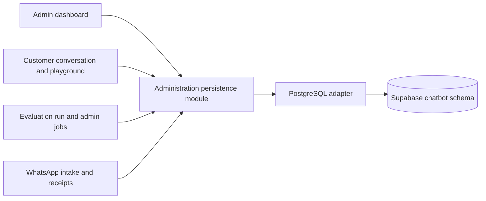

# Supabase administration state migration

Date: 2026-10-15, Asia/Jakarta.

Status: written spec approved by the user's instruction to continue implementation on 2026-10-15. The implementation plan still requires review and execution-method selection under the chosen brainstorming workflow. Live cutover remains subject to the preflight and preservation requirements below.

## Intent and agreed decisions

Prepare the existing FastAPI backend for eventual deployment alongside React in one Vercel project. This first sub-project moves administration state from local SQLite to managed PostgreSQL without changing customer-facing RAG behavior.

The user selected:

- Supabase project `ndgfipshsgqmqnsmjhzz` as the migration destination.
- Migration of all existing SQLite application data, rather than an empty database.
- A scheduled maintenance interval for the final snapshot and cutover.
- Preservation of IDs, password hashes, session expiry, job results, Pinecone namespaces, and the selected published knowledge version.

Success means the existing application can use shared PostgreSQL state and preserve its observable behavior after a verified migration. It does not mean the entire application is ready for Vercel: durable execution, cloud artifacts, embedding packaging, routing, and production WAHA connectivity are subsequent work.

## Existing decisions and scope

ADRs 0001–0003 remain in force: Pinecone is the vector store; LangSmith receives traces and evaluation reports; draft knowledge requires indexing and review before explicit publication.

Keep multilingual E5-small, 384 dimensions, prefixes, normalization, chunking settings, prompts, model choices, and retrieval settings unchanged. Do not re-embed, create replacement Pinecone namespaces, or publish a different version as a side effect of moving state.

### Included

- PostgreSQL schema and explicit schema migrations.
- One PostgreSQL adapter behind the administration persistence module.
- Removal of caller-owned SQL from dashboard authentication, admin jobs, and WAHA state operations.
- A client-side SQLite import and verification procedure, with maintenance, reconciliation, and rollback requirements.
- Startup behavior that checks readiness without global job recovery or business-data bootstrap.
- Local operation against Supabase after cutover, retaining local artifact files until their separate migration.

### Deferred

- Vercel deployment, frontend routing, and custom Docker packaging.
- Replacing the daemon WhatsApp worker or admin executor with durable queue consumers.
- Moving knowledge documents, reviewed/generated datasets, and evaluation exports to object storage.
- Supabase Auth, direct browser database access, pgvector, a new ORM, and permanent SQLite/PostgreSQL dual support.
- Dashboard redesign, broad package renaming, and unrelated RAG improvements.

## Source inventory

The read-only inventory observed eight application tables and 226 rows. These counts are a reference, not the final cutover counts; the application may receive new data before maintenance.

| Table | Observed rows | Preservation requirements |
| --- | ---: | --- |
| `users` | 1 | Name, salt, and scrypt hash; existing password remains valid. |
| `sessions` | 4 | Token hashes, CSRF values, and original expiry; expired sessions stay expired. |
| `settings` | 5 | All keys and values, including published version and history/reset markers. |
| `versions` | 8 | IDs, namespace, status, manifest, records including stored embeddings, errors, and timestamps. |
| `jobs` | 5 | IDs, kind, payload, result, error, timestamps, status, and progress. |
| `conversations` | 200 | Numeric IDs, session/channel, text, usage, latency, trace ID, and timestamps. |
| `whatsapp_inbox` | 1 | Composite identity, sender including LID, original message, answer, media, reply IDs, and state. |
| `whatsapp_receipts` | 2 | Provider message ID, highest observed acknowledgement, and timestamp. |

The observed published version was `draft-ffa4eb9c27fb`. The final snapshot is authoritative; validate its selected version rather than hard-coding this observed ID.

The project-scoped MCP endpoint was reachable and its `public` schema had no tables. This does not establish that every schema is empty. Implementation must inspect the intended application schema before applying DDL or importing rows. A different connector could not inspect this project; use the confirmed project-scoped connection, not another project's credentials.

## Architecture and module depth

The existing `app/admin/store.py` contains useful domain behavior, but its public raw connection interface leaks schema, SQL dialect, serialization, and transaction ordering into callers.

Deepen that existing module rather than adding a forwarding repository hierarchy. Its interface owns administration persistence operations; its PostgreSQL adapter owns SQL, connection handling, transactions, and database errors at the persistence seam. This increases locality for state changes and leverage across dashboard, RAG, job, and WhatsApp callers.

Existing domain operations such as version selection, publication, conversation history, reset markers, and configuration retain their calling behavior. Add only the operations needed to absorb SQL already present in routes, jobs, and WAHA. Caller code must not assemble SQL or depend on PostgreSQL cursor objects.

The interface is the test surface: verify auth, publication, history, progress, and delivery state through the same operations callers use. Deleting a new forwarding module should not merely move SQL elsewhere; avoid creating such a module. A permanent SQLite adapter is not required. The standard-library SQLite reader remains available to migration tooling, and the previous application is retained for controlled rollback.

### Files reached by this change

- `app/admin/store.py`: persistence, transaction ownership, readiness, and schema-version checks.
- `app/admin/routes.py`: authentication/session callers and shared login throttling.
- `app/admin/jobs.py`: job state and progress callers; executor remains single-process in this phase.
- `app/integrations/waha.py`: inbox, acknowledgement, claim, recovery, and status callers.
- `app/dependencies.py` and `app/main.py`: startup and worker lifecycle.
- `app/config/settings.py`, `.env.example`, and `requirements.txt`: backend-only connection configuration and pinned PostgreSQL dependencies.
- Explicit SQL migration files and a small migration command, in locations defined by the implementation plan.
- Existing auth, knowledge workflow, progress, and WAHA fixtures whose setup currently assumes SQLite.

`app/admin/knowledge.py`, `app/backend/chain.py`, and `testing/evals/runner.py` remain consumers of the persistence module. Their filesystem behavior is retained for local operation; changes are limited to actual interface compatibility needs.

## PostgreSQL storage and access

Use a dedicated `chatbot` schema that is not exposed through the Supabase Data API. Inspect existing schema ownership and contents before creating anything. Never drop, truncate, or overwrite unrelated project objects.

Use Psycopg 3 for SQL access. A new ORM or Supabase SDK is unnecessary for this migration. Runtime uses the Supabase transaction pooler with SSL, automatic prepared statements disabled, and a small bounded per-instance connection pool. Start with at most two client connections per instance. Return connections promptly; never hold a transaction across an LLM request, Pinecone operation, HTTP send, or file processing. Bound connection acquisition and query time so database failure cannot leave requests waiting indefinitely.

Use schema-qualified identifiers. Migrations/imports use a separate privileged connection; runtime uses a dedicated application role with only required schema, table, and sequence permissions. Do not grant `anon`, `authenticated`, or `PUBLIC` application data access. Apply RLS as defense in depth with policies scoped to the backend application role; these are single-business backend tables, so do not invent `auth.uid()` ownership rules or migrate login to Supabase Auth.

Expose `DATABASE_URL` only to the Python backend environment. Use a separate administrative connection value for explicit migration commands. Do not print DSNs, role passwords, password hashes, CSRF values, or source rows in logs, reports, tool prompts, or frontend bundles. Transfer source rows directly from the local migration process to PostgreSQL over TLS.

### Data compatibility

- Retain the eight source table identities and domain fields.
- Preserve existing text, nullable values, JSON text, and ISO timestamp representations. Keep JSON-bearing source fields as text for this phase to avoid unrelated serialization changes.
- Use PostgreSQL integers/double precision as appropriate for source numeric fields; do not convert missing quality values to zero or extend session expiry.
- Preserve source primary/unique keys, including `(session, message_id)` for WhatsApp deduplication and unique namespaces for knowledge versions.
- Explicitly preserve conversation IDs and advance the PostgreSQL identity sequence past the largest imported ID.
- Convert SQLite-specific conflict behavior into explicit PostgreSQL upserts; do not emulate SQLite SQL with string replacement.
- Preserve the highest observed acknowledgement with a monotonic update.
- Serialize publication through a transaction and lock, enforce at most one published version, and atomically update its selection marker. Invalid or failed publication leaves the previous selection unchanged.
- Migration records and schema-version bookkeeping may add internal tables, but they are not additional source business data.

## Lifecycle and concurrency

Ordinary startup validates connectivity, schema version, and the presence of the selected published version. It must not run schema DDL, import historical rows, generate credentials, seed baseline knowledge, ingest Pinecone vectors, or publish a version.

Remove automatic global resets of queued/running jobs, indexing versions, and generating/sending inbox items from normal startup. Schema migration and first-time provisioning are explicit operator actions. Recovery of interrupted work is explicit and recorded; an instance starting does not prove another instance has stopped.

Move login attempt tracking out of the process-local dictionary into shared, expiring database state, preserving its existing behavioral limit. Hash the client identity used by that state and avoid introducing a new public data surface.

Use an atomic inbox claim when selecting the next queued WhatsApp item; two callers cannot both claim it. Preserve message deduplication, HMAC validation, ignored own/group/empty events, and LID sender identifiers. A timeout after a provider send remains `uncertain`; do not promise exactly-once delivery or automatically resend an uncertain item.

This is correctness work for shared state, not the durable execution sub-project. Keep one local backend worker process after this phase. Do not activate multiple Vercel workers or claim reliable serverless job execution until the durable execution phase is complete. Do not retain a database lock or transaction for the duration of an evaluation run or indexing operation.

## Migration and cutover

### Preflight and rehearsal

1. Confirm the target project ref and schema from the actual connection. Abort on mismatch or unexpected nonempty application tables. Inspect the complete source schema and fail on unsupported source tables/columns rather than silently omit them.
2. Retain a runnable copy of the previous application/configuration and its working dependencies, including relevant uncommitted files. Never reset or clean the user's working tree as a rollback mechanism.
3. Validate schema creation and import against an isolated rehearsal schema or database. Use a consistent SQLite backup through its backup API, not a plain copy of a live database that may have WAL entries.
4. Verify restored data and cleanup only the rehearsal objects created by this migration. Rehearsal must not write to live application tables or switch the running backend.
5. Verify WAHA history enumeration on the connected GOWS session before scheduling cutover. The documented message endpoint supports pagination, time filtering, and original message IDs; verify the installed version returns complete data for this account, including LID chats. Do not infer completeness from one page or rely on webhook retries alone.

If history completeness, message identity, required credentials, backup restoration, or destination identity cannot be verified, stop before cutover and keep SQLite active. Do not silently substitute a weaker migration procedure.

### Scheduled maintenance

1. Record a UTC start watermark before stopping writes. Keep the Linux WAHA process, its message storage, network access, and session active.
2. Block dashboard/playground mutations and new admin jobs. Drain active processing; if a job or delivery cannot settle, classify its actual state explicitly before the snapshot. Never mark an ambiguous send safe to retry.
3. Stop the local backend and every process that can write the source database. Messages may continue arriving at WAHA during this interval; the maintenance window is not represented as normal chatbot availability.
4. Create the final consistent SQLite backup, checksum, source schema inventory, per-table row counts, and manifest. Protect backup files with owner-only access. The source database and backup remain unchanged thereafter.
5. Apply explicit versioned PostgreSQL migrations. Import the eight source tables in a transaction. Abort on unexpected destination data; do not merge unrelated rows. Record the source snapshot identity so repeating the same completed import verifies/no-ops rather than duplicates data. A failed transaction leaves no partial source import.
6. Compare full key sets and canonical per-row/per-table content digests, not just counts. Check nulls, JSON text, numeric values, original timestamps, credentials/expiry, stored record embeddings, reply IDs, and sequence position. Validate published-version status, selection marker, manifest, and exact existing Pinecone namespace. This step must not upsert or delete vectors.
7. Start the PostgreSQL-backed backend in maintenance with job execution and customer sends disabled. Readiness/authentication checks before the commit point are read-only or rolled back; do not accidentally create a live session or process work while verification is incomplete.
8. Once verification passes, record the cutover commit point and enable PostgreSQL intake. From the first durable new write onward, simple rollback to the old SQLite snapshot is no longer allowed.
9. Record an end watermark after new intake is accepting events. With customer processing still paused, enumerate every relevant WAHA chat and message covering the closed maintenance interval, with overlap on both watermarks to cover timestamp granularity. Read without marking chats read or downloading unnecessary media. Deduplicate all pages by original message ID.
10. Compare eligible inbound private text message IDs with the imported/new inbox. Insert only missing items using the same validation and deduplication rules, retaining original sender and message time. Existing items, stored answers, and reply IDs must not be overwritten. Duplicates whose contents conflict require operator review. Reconcile known outbound receipt status where available; retain uncertainty when provider state is unavailable.
11. Review the reconciliation summary and require every eligible interval message to be accounted for before enabling customer processing. Previously sent messages remain sent; unresolved uncertain sends remain withheld. Resume queued messages in conversation order, then reopen dashboard mutations and admin job admission.

Reconciliation is an explicit maintenance tool, not a new public replay endpoint. Its summary records counts and digests without message content or credentials. Validate its pagination and end-watermark behavior before the live maintenance window. Obtain real source/target state again at execution time; the observed 226 rows are not a required fixed total.

## Rollback and error handling

- Before new PostgreSQL writes: stop the replacement backend and restore the previous application/configuration against the preserved SQLite source. Reconcile the same WAHA maintenance interval into SQLite before resuming processing; rollback does not erase messages received during the window.
- After new PostgreSQL writes: enter maintenance again, preserve both databases and provider history, and perform a controlled reverse transfer/reconciliation of all new or changed state before restoring SQLite. Do not implement or advertise an automatic environment-variable flip. If reverse transfer has not been validated, keep maintenance active and repair PostgreSQL instead of reopening stale SQLite.
- Migration failure never changes the published selection, sends a WhatsApp message, or imports a different baseline. Provider calls used for reconciliation are read-only.
- Missing runtime credentials/schema or unavailable PostgreSQL produces a clear readiness failure. Never silently fall back to an empty local database.
- Sanitize database/provider errors before returning them to the dashboard. Preserve useful failure state without exposing connection strings or row contents.

## Planned acceptance checks

These are requirements for the implementation plan; no project tests or live migration are executed as part of writing this spec.

1. Source snapshot restores; all eight tables match final snapshot key sets, counts, and content digests. A repeated import cannot duplicate rows or overwrite a different snapshot.
2. Existing password verifies; CSRF/origin protections and session expiry retain their behavior; login throttling applies across callers.
3. Conversation IDs and reset markers preserve prompt history/audit semantics, and the next inserted ID exceeds imported IDs.
4. Published selection remains identical. Failed or concurrent publication cannot expose a draft or leave multiple published versions.
5. Job progress, partial metric failures, result fields, and reporting retry state survive the transfer. Ordinary startup does not alter another caller's work.
6. HMAC, deduplication, ignored events, monotonic receipts, atomic claims, text fallback, and uncertain-delivery handling retain their behavior.
7. Maintenance reconciliation accounts for new chats, LID messages, duplicate pages, watermark overlap, and messages received while the backend is stopped. No historical sent message is requeued.
8. Runtime role can perform required operations while frontend/Data API roles cannot read application tables. Logs and migration reports contain no secrets or source content.
9. Pre-commit rollback restores the old application with reconciled maintenance messages. Post-commit rollback remains blocked until new state is safely transferred.
10. Existing local documents and evaluation exports still work after the database switch; neither this outcome nor a passing health endpoint is described as full Vercel deployment readiness.

Existing behavior checks to preserve include `testing/test_admin_workflow.py`, `testing/test_dashboard_progress.py`, and `testing/test_waha_integration.py`. Their SQLite-specific setup must be adapted without weakening assertions. PostgreSQL-specific transaction and concurrency checks require a real isolated PostgreSQL target rather than a mock of SQL execution.

## Design review and next stage

This spec chooses a single production PostgreSQL adapter, backend-only application state, explicit schema migration, a scheduled verified cutover, and conservative handling of provider uncertainty. It introduces no generic storage framework and does not replace the established RAG pipeline.

The next stage is user review of this committed written spec. After approval, create the implementation plan, including the exact migration commands, maintenance controls, verification procedure, and execution-method selection. Changes to the maintenance mechanism or preservation guarantees must be reflected here before implementation.

## References

- [Supabase connection methods and pooler](https://supabase.com/docs/guides/database/connecting-to-postgres)
- [Psycopg transaction management](https://www.psycopg.org/psycopg3/docs/basic/transactions.html)
- [Psycopg prepared statements and pooling](https://www.psycopg.org/psycopg3/docs/advanced/prepare.html)
- [WAHA message history, filters, and pagination](https://waha.devlike.pro/docs/how-to/chats/)
- [Vercel Functions runtime lifecycle and storage](https://vercel.com/docs/functions/runtimes)
- Existing project ADRs: `docs/adr/0001-pinecone-vector-store.md`, `0002-langsmith-tracing-and-evaluation-results.md`, and `0003-publish-reviewed-knowledge-versions.md`.
